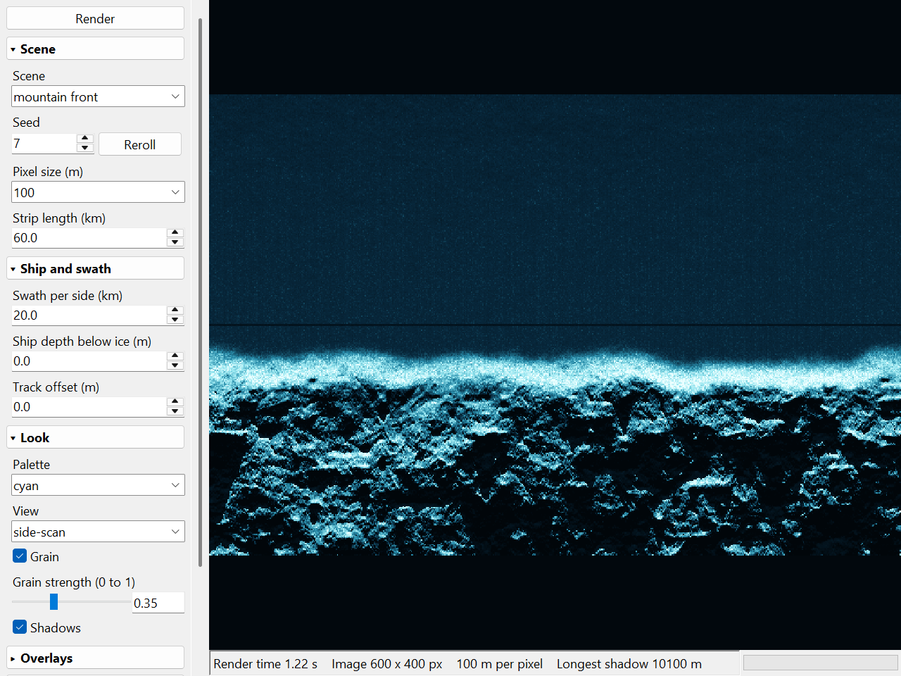
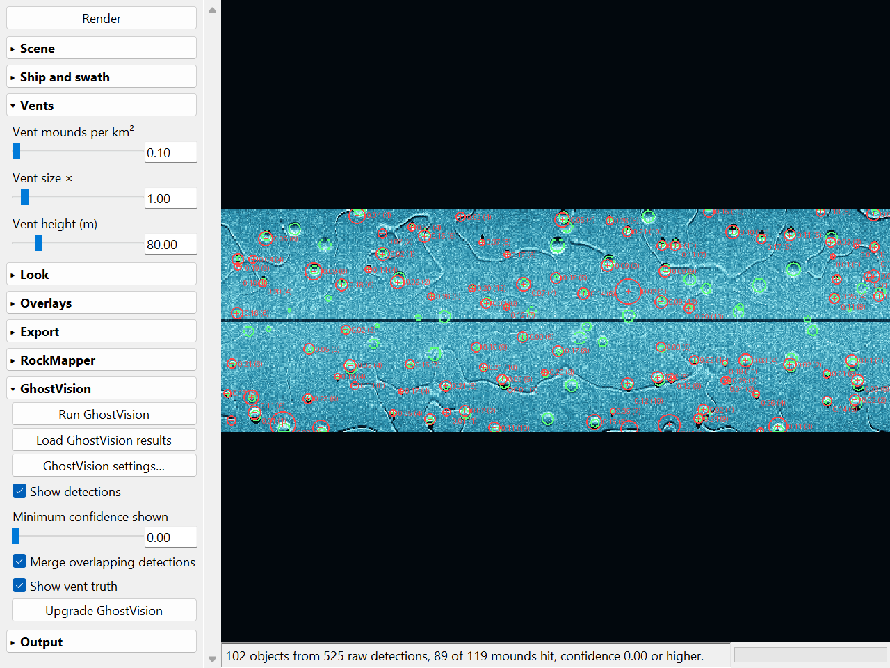
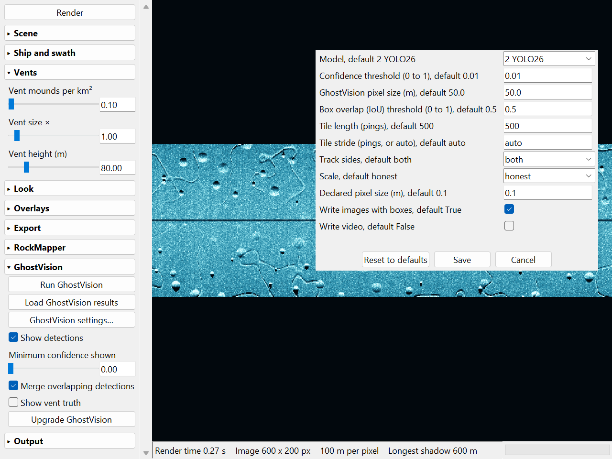

# Sonar Studio

Sonar Studio renders synthetic side-scan sonar images of the seafloor in a desktop window. You pick a terrain area under the ship (mountain front, mountain interior, trench edge, vent field or plain floor) and edit its settings: seed, pixel size, swath, ship depth, vent mound frequency, size and height, palette, grain and shadows. It exports each render as GeoTIFFs for RockMapper and as sonogram tiles for GhostVision, runs either tool, and draws their answers over the image next to the true vent mound outlines.







## Requirements

- Windows 10 or 11. The launchers are `.cmd` files, and the RockMapper and GhostVision steps use Miniforge on Windows.
- Python 3.13 (tested with 3.13.14), with tkinter. The python.org Windows installer includes tkinter. On Linux, install your distribution's `python3-tk` package; the window runs there, the `.cmd` launchers do not.
- numpy, scipy and Pillow. `requirements.txt` pins the tested versions.

## Install

```
pip install -r requirements.txt
```

## Run

Double-click `Sonar Studio.cmd`. It starts the app with `pythonw` (no console window) and falls back to `python`.

From a terminal, in this folder:

```
python sonar_studio.py
```

`python sonar_studio.py --smoke` opens the window and closes it after 2 s.

`python sonar_studio.py --screenshot PATH --shot mountain|vents|dialog [--runs DIR]` renders a set scene, saves a PNG of the window and quits (Windows only). The three images above come from it. `--runs` names a folder of GhostVision run folders for the `vents` picture.

## Controls

The left panel holds Render and nine sections. Click a section header to open (▾) or close (▸) it. `sections.json` saves which sections are open. The panel scrolls with the mouse wheel when it is taller than the window.

| Section | Controls |
|---|---|
| Scene | Scene, Seed, Pixel size, Strip length |
| Ship and swath | Swath per side, Ship depth below ice, Track offset |
| Vents | Vent mounds per km², Vent size ×, Vent height (m). Shown for the vent field scene only. |
| Look | Palette, View, Grain, Grain strength, Shadows |
| Overlays | Area boxes |
| Export | Save PNG, Export for RockMapper, Export for GhostVision |
| RockMapper | Run RockMapper, Upgrade RockMapper, Declared scale, Declared pixel size |
| GhostVision | Run GhostVision, Load GhostVision results, GhostVision settings…, Show detections, Minimum confidence shown, Merge overlapping detections, Show vent truth, Upgrade GhostVision |
| Output | Open in console window |

| Control | Effect |
|---|---|
| Scene | Picks the area under the ship: mountain front, mountain interior, trench edge, vent field or plain floor. |
| Seed | Sets the terrain and speckle seed. Reroll picks a random seed. |
| Pixel size (m) | Sets meters per pixel: 5, 10, 20, 50, 100 or 200 m. Smaller pixels render slower. The app refuses images over 20 million pixels. |
| Strip length (km) | Sets the along-track length of the strip. Default 60 km. |
| Swath per side (km) | Sets the sonar range on each side of the ship track. Default 10 km. |
| Ship depth below ice (m) | Lowers the ship. A deeper ship casts shorter shadows. |
| Track offset (m) | Moves the ship track across the scene, toward or away from the area edge. |
| Vent mounds per km² | Slider, 0 to 10 mound clusters per square kilometer. Default 0.1. 0 draws no mounds. |
| Vent size × | Slider, 0.25 to 10. Multiplies mound width (300 m to 1,500 m at size 1) and fissure length and width. Mound height stays the same. Default 1. |
| Vent height (m) | Slider, 5 to 400 m. Sets the tallest mound height; each mound is 30 % to 100 % of it. Fissure depth follows it (15 m at 80 m). Default 80 m. |
| Palette | Colors the image cyan or amber. |
| View | Shows the side-scan image or the truth hillshade (true terrain, lit from the northwest). |
| Grain | Adds display grain anchored to world cells. Grain strength runs from 0 (none) to 1 (full speckle). With grain off, the image carries random speckle instead. |
| Shadows | Turns acoustic shadows behind high ground on or off. |
| Area boxes | Draws the terrain area box and the ship track over the image. |
| Render | Renders with the current settings. |
| Save PNG | Saves the current image at full resolution. |
| Export for RockMapper | Writes the current render as a GeoTIFF to `rockmapper_out/input/honest/` or `rockmapper_out/input/declared/`. |
| Declared scale (RockMapper) | Writes the declared pixel size into RockMapper exports in place of the render pixel size. |
| Declared pixel size (m) | Sets the declared pixel size. Default 0.1 m. |
| Run RockMapper | Runs `Run RockMapper.cmd` on the exported GeoTIFFs at both scales. Results go to `rockmapper_results/`. |
| Export for GhostVision | Writes the current render as JPG tiles to `ghostvision_out/tiles/<scale>/`, with its vent truth mask. |
| GhostVision settings… | Opens the GhostVision settings dialog. |
| Run GhostVision | Tiles the displayed render into its own run folder `ghostvision_out/runs/<slug>_<time>/`, runs GhostVision on that folder in the background, then draws its detections. The status bar shows objects, raw detections and mounds hit. |
| Load GhostVision results | Loads the newest run folder made for the displayed render and the current scale. |
| Show detections | Circles GhostVision detections in red. After Run RockMapper, it also tints the image with the RockMapper class map. A new render clears the detections of the previous one. |
| Minimum confidence shown | Hides detections below this confidence, 0 to 1, default 0. The saved results do not change. |
| Merge overlapping detections | Draws one mark per object, default on. Tiles overlap, so GhostVision finds one object in several tiles. Boxes whose centers lie within half a box side merge into one circle, labeled with the highest confidence and the box count. The merge uses the boxes only, never vent truth. |
| Show vent truth | Outlines each vent mound in green where it stands above 25 % of its own peak height. Touching mounds get separate outlines. |
| Upgrade RockMapper, Upgrade GhostVision | Upgrades the tool's conda env after a confirmation dialog. The log and status bar show the installed version before and after. |
| Open in console window | Off: tool output shows in a log window that keeps the last 5,000 lines, with Copy and Clear buttons. On: the tool runs in a visible cmd window. Default off. |

Each slider has a box beside it. Type a number and press Enter, or leave the box, to set it. The box rejects text that is not a number. Values outside the slider's range clamp to the nearest end.

Hovering over a control for 0.5 s shows a tooltip with its range and default.

A change to any control starts a new render when the last render took under 1 s. Slower settings wait for Render. The bar at the bottom right shows render, export and GhostVision progress.

## RockMapper and GhostVision

RockMapper and GhostVision are side-scan sonar tools from the PING Ecosystem (https://github.com/PINGEcosystem). Each runs in its own conda env as a separate program. Sonar Studio never imports their code: it writes files they read and reads files they write.

| Tool | Task | Output |
|---|---|---|
| RockMapper 1.0.0a11 | Semantic segmentation (SegFormer). Classes: NoData, Shadow, Other, Gravel, Cobble Boulder, Bedrock. | Class raster per input GeoTIFF |
| GhostVision 1.0.0 | Object detection of crab pots (YOLO26, YOLOv12 and RF-DETR models) | Boxes with class and confidence |

### Install the tools

Install Miniforge to `%USERPROFILE%\miniforge3`. From a Miniforge prompt:

```
pip install --force-reinstall pinginstaller
python -m pinginstaller rockmapper
python -m pinginstaller ghostvision-gpu
```

PINGInstaller creates the `rockmapper` and `ghostvision` envs. The RockMapper model ships inside the `rockmapper` package. GhostVision downloads three models to `%USERPROFILE%\.ghostvision\models\ghostvision-models` (`1` RF-DETR, `2` YOLO26, `5` YOLOv12) on its first launch with `python -m ghostvision`.

### Upgrade the tools

Upgrade RockMapper and Upgrade GhostVision run `Upgrade RockMapper.cmd` and `Upgrade GhostVision.cmd`. Each launcher also runs on its own from Explorer. It runs the install commands above in Miniforge's base env. From the PINGInstaller source (`pinginstaller/Install_Update.py`, read 24 October 2026):

- PINGInstaller updates an existing env in place with `conda env update --prune`. `--prune` removes packages that the tool's env file does not list.
- It also updates every package in the base env and cleans the conda package cache.
- It downloads packages from the internet, often several GB. It downloads no models.

Upgrade GhostVision has one extra step, on by default: a checkbox in the confirmation dialog, or the argument `withinference` to `Upgrade GhostVision.cmd`. It keeps `inference-gpu` at 1.x (tested with 1.8.2) after PINGInstaller runs. PINGInstaller's `--prune` can roll it back to 0.64.8. The step:

1. Installs `pycuda` prebuilt from conda-forge with mamba. pip would compile it from source, which needs Microsoft C++ Build Tools.
2. Runs `pip install --upgrade inference-gpu`.
3. Reinstalls `inference-sdk`, `inference-gpu` and `inference-models` with `--force-reinstall --no-deps`. Removing 0.64 deletes files that `inference-sdk` also owns, and the import `inference_sdk.http.entities` then fails.

GhostVision results on 1.8.2 matched 0.64.8 (24 October 2026).

GhostVision can stop partway with a joblib `BrokenProcessPool` error during inference (seen on 24 October 2026). Run it again; the same command then succeeded.

### Scale

RockMapper was trained on river fishfinder mosaics at centimeter pixels and reads 18 m x 18 m windows. Sonar Studio renders at 5 m to 200 m per pixel. Each export has two modes:

- Honest: the file states the render pixel size.
- Declared: the file states a fine pixel size (default 0.1 m), so an 18 m RockMapper window covers 180 x 180 px.

GhostVision tiles carry no pixel size, so both modes hold the same pixels. Each tile is one side of the track as a sonogram: ship track on row 0, range down the rows, 500 pings (columns) wide.

### GhostVision settings

The GhostVision settings dialog writes `ghostvision_settings.json`. Export for GhostVision, Run GhostVision, `ghostvision_feed.py` and `Run GhostVision.cmd` with no arguments read it. Flags on `ghostvision_feed.py` override single settings.

GhostVision always gets a fresh render of the displayed scene and seed at the GhostVision pixel size (default 50 m). Its detections scale back onto the displayed render.

| Setting | Flag | Default | Range |
|---|---|---|---|
| Model | `--model` | `2` (YOLO26) | `1` RF-DETR, `2` YOLO26, `5` YOLOv12 |
| Confidence threshold | `--confidence` | 0.01 | 0 to 1 |
| GhostVision pixel size (m) | `--px` | 50 m | 5 m to 200 m |
| Box overlap (IoU) threshold | `--iou` | 0.5 | 0 to 1 |
| Tile length (pings) | `--tile-pings` | 500 | 50 to 5,000 |
| Tile stride (pings) | `--stride-pings` | auto | 10 to 5,000, or auto |
| Track sides | `--sides` | both | both, port, star |
| Scale | `--mode` | honest | honest, declared |
| Declared pixel size (m) | `--declared-px` | 0.1 m | 0.01 m to 5 m |
| Write images with boxes | `--export-image` | on | on, off |
| Write video | `--export-video` | off | on, off |

Auto stride is the tile length minus 3 times the largest mound diameter in pixels, at least 10 pings. At defaults: 500 - ceil(3 x 1,500 m / 50 m) = 410 pings. Every mound then lies whole inside at least one tile.

### Command line

```
python rockmapper_feed.py export          renders 4 test scenes, writes GeoTIFFs
"Run RockMapper.cmd"                      runs RockMapper, writes rockmapper_results/
python ghostvision_feed.py export         renders 4 test scenes, writes tiles
"Run GhostVision.cmd"                     runs GhostVision with the saved settings
```

Both `export` commands take `--vents N`, `--vent-size X`, `--vent-height M`, `--px M`, `--strip-km K` and `--swath-km K`. `rockmapper_results/` holds each input beside its class map and `class_fractions.json`. `ghostvision_results/` holds each render with merged detections circled and `detections.json`.

## Results

GhostVision on the default vent field, 24 October 2026: 0.1 mounds per km², vent size 1, vent height 80 m, seed 7, 50 m per pixel, YOLO26 at confidence 0.01, auto tile stride (410 pings), merged detections.

| Measure | Result |
|---|---|
| Mounds found | 89 of 119 (75 %) |
| Objects centered on a mound | 83 of 102 (81 %) |
| Image area covered by mounds | 5 % |
| Detections on plain floor | 0 |

These numbers come from one seed and one setting.

## Tests

```
python test_render.py
```

The test renders every scene and checks image size, seed changes, vent frequency, size and height rules, the vent truth mask, the 20 million pixel limit, settings files, tile mapping, detection merging, the log window, upgrade commands (with a fake command) and tooltips. It reads recorded RockMapper and GhostVision output from `testdata/` and needs neither tool installed. It writes `screenshot.png` and `screenshot_vents.png`.

## Files

| File | Contents |
|---|---|
| `sonar_studio.py` | The window |
| `sonar_core.py` | Rendering without GUI code: side-scan shading, shadows, grain, tone mapping |
| `terrain.py` | Seafloor heights and materials for mountain and trench areas, noise, palettes |
| `vent_shapes.py` | Vent mounds, fissures and vent truth |
| `vent_defaults.json` | Vent mound and fissure numbers |
| `detector.py` | Shared interface for outside tools: detections, scoring, drawing, launching |
| `rockmapper_adapter.py`, `ghostvision_adapter.py` | Export, run, read and summarize for each tool |
| `rockmapper_feed.py`, `ghostvision_feed.py` | Command-line entry points |
| `tile_index.py` | GhostVision tile cutting and box mapping |
| `proc_log.py` | Tool output log window |
| `sections.py`, `slider_entry.py`, `tooltips.py` | Panel sections, slider boxes, tooltip text |
| `test_render.py`, `testdata/` | Tests and recorded tool output |
| `*.cmd` | Launchers for the app, the tools and their upgrades |

The app writes `sections.json`, `ghostvision_settings.json`, `rockmapper_out/`, `ghostvision_out/` and the results folders next to itself. Git ignores them.

## License

MIT. See `LICENSE`. RockMapper and GhostVision are separate programs under their own licenses and are not included; see `THIRD_PARTY_NOTICES.md`.
